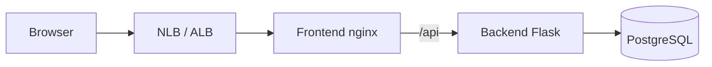

# three-tier-eks-iac (Project 2)

**Author:** [Yashas Suresh](https://github.com/yashassuresh775)  
**Repo:** https://github.com/yashassuresh775/project-2

Original three-tier application on **Amazon EKS** (not a fork of the workshop Mongo/Node reference):

| Tier | Component |
| --- | --- |
| Web | Nginx frontend (static UI + `/api` reverse proxy) |
| API | Flask + Gunicorn backend |
| Data | PostgreSQL 16 in-cluster |

Infrastructure is provisioned with **Terraform** (VPC, EKS managed node group, ECR, IRSA for addons). Workloads and edge traffic use **Kubernetes manifests**. Optional **Prometheus + Grafana** via Helm.

---

## Architecture

```text
Internet → NLB (full-stack-lb) → Frontend (nginx)
                                      │ /api/*
                                      ▼
                                   Backend (Flask)
                                      │
                                      ▼
                                   PostgreSQL
```



---

## Prerequisite

Install tools before you start:

- [kubectl](https://kubernetes.io/docs/tasks/tools/)
- [Helm](https://helm.sh/docs/intro/install/) — then `helm repo update`
- [AWS CLI v2 only](https://aws.amazon.com/cli/)
- [Terraform](https://developer.hashicorp.com/terraform/install) >= 1.5
- Docker Desktop (or Docker Engine) with buildx preferred on Mac

Configure AWS credentials (`aws configure` or SSO) with rights to create VPC / EKS / ECR / IAM / EC2.

---

## 0) Local smoke test (optional)

```bash
docker compose up --build
```

Open http://localhost:8080 — add an item to confirm frontend → backend → Postgres.

---

## 1) Provision EKS (Terraform)

```bash
cd terraform
cp terraform.tfvars.example terraform.tfvars
# edit region / sizes if needed
terraform init
terraform apply
```

Terraform creates:

- VPC (public + private subnets, NAT, IGW)
- EKS cluster + managed node group (autoscaler tags)
- Private ECR repos for frontend/backend
- IRSA roles for Cluster Autoscaler and AWS Load Balancer Controller

---

## 2) Update the Kubernetes context

```bash
aws eks update-kubeconfig --name three-tier-eks --region us-east-1
```

Or use the printed Terraform output:

```bash
$(terraform -chdir=terraform output -raw configure_kubectl)
```

### Verify access

```bash
kubectl auth can-i "*" "*"
kubectl get nodes
```

---

## 3) Install cluster addons (Autoscaler, LB Controller, Grafana)

```bash
./scripts/install-addons.sh
```

To skip monitoring (e.g. before a demo):

```bash
SKIP_MONITORING=1 ./scripts/install-addons.sh
# or later:
./scripts/disable-monitoring.sh
```

### Verify Autoscaler running

```bash
kubectl get pods -n kube-system
kubectl logs -f -n kube-system -l app=cluster-autoscaler
```

### Check load balancer controller logs

```bash
kubectl logs -f -n kube-system \
  -l app.kubernetes.io/name=aws-load-balancer-controller
```

---

## 4) Build Docker images

### For Mac (buildx / amd64 for EKS nodes)

```bash
export DOCKER_CLI_EXPERIMENTAL=enabled
AWS_REGION=us-east-1 IMAGE_TAG=v1 ./scripts/build-push-ecr.sh
```

Manual equivalent:

**Build Front End**

```bash
cd app/frontend
docker buildx build --platform linux/amd64 -t three-tier-frontend:v1 .
# tag/push via script output or:
# docker tag three-tier-frontend:v1 <ACCOUNT>.dkr.ecr.us-east-1.amazonaws.com/three-tier-eks-frontend:v1
# docker push ...
```

**Build Back End**

```bash
cd app/backend
docker buildx build --platform linux/amd64 -t three-tier-backend:v1 .
```

### For Linux / Windows

```bash
AWS_REGION=us-east-1 IMAGE_TAG=v1 ./scripts/build-push-ecr.sh
```

Or manually:

**Build Front End**

```bash
docker build -t three-tier-frontend:v1 ./app/frontend
docker tag three-tier-frontend:v1 <ACCOUNT>.dkr.ecr.us-east-1.amazonaws.com/three-tier-eks-frontend:v1
docker push <ACCOUNT>.dkr.ecr.us-east-1.amazonaws.com/three-tier-eks-frontend:v1
```

**Build Back End**

```bash
docker build -t three-tier-backend:v1 ./app/backend
docker tag three-tier-backend:v1 <ACCOUNT>.dkr.ecr.us-east-1.amazonaws.com/three-tier-eks-backend:v1
docker push <ACCOUNT>.dkr.ecr.us-east-1.amazonaws.com/three-tier-eks-backend:v1
```

Copy the printed `BACKEND_IMAGE` / `FRONTEND_IMAGE` values from the script.

---

## 5) Create Namespace

```bash
kubectl create ns three-tier
# or:
kubectl apply -f k8s/namespace.yaml

kubectl config set-context --current --namespace three-tier
```

---

## 6) PostgreSQL Database Setup

To create PostgreSQL resources:

```bash
cd k8s/postgres
kubectl apply -f secret.yaml
kubectl apply -f deployment.yaml
kubectl apply -f service.yaml
```

Wait until ready:

```bash
kubectl -n three-tier rollout status deploy/postgres
kubectl -n three-tier get pods -l app=postgres
```

---

## 7) Backend API Setup

Create the Flask API deployment:

```bash
export BACKEND_IMAGE=<ACCOUNT>.dkr.ecr.us-east-1.amazonaws.com/three-tier-eks-backend:v1

sed "s|IMAGE_BACKEND|${BACKEND_IMAGE}|g" k8s/backend/deployment.yaml | kubectl apply -f -
kubectl apply -f k8s/backend/service.yaml
```

---

## 8) Frontend setup

Create the Frontend resources:

```bash
export FRONTEND_IMAGE=<ACCOUNT>.dkr.ecr.us-east-1.amazonaws.com/three-tier-eks-frontend:v1

sed "s|IMAGE_FRONTEND|${FRONTEND_IMAGE}|g" k8s/frontend/deployment.yaml | kubectl apply -f -
kubectl apply -f k8s/frontend/service.yaml
```

---

## 9) Internet LoadBalancer

Finally create the load balancer to allow internet traffic:

```bash
kubectl apply -f k8s/full_stack_lb.yaml
kubectl -n three-tier get svc full-stack-lb -w
```

Open `http://<EXTERNAL-IP>/` once an address appears.

### Optional: ALB Ingress (after AWS LB Controller is installed)

```bash
kubectl apply -f k8s/ingress.yaml
kubectl -n three-tier get ingress full-stack-ingress
```

### One-shot deploy helper

```bash
export BACKEND_IMAGE=...
export FRONTEND_IMAGE=...
./scripts/deploy-k8s.sh
```

---

## Troubleshooting

Any issue with the pods? Check logs:

```bash
kubectl -n three-tier get pods
kubectl logs -f -n three-tier deploy/backend
kubectl logs -f -n three-tier deploy/frontend
kubectl logs -f -n three-tier deploy/postgres
# or a specific pod:
kubectl logs -f POD_NAME -n three-tier
```

Common checks:

```bash
kubectl -n three-tier describe pod <pod>
kubectl -n three-tier get events --sort-by='.lastTimestamp'
curl http://<EXTERNAL-IP>/api/health
```

---

## Grafana setup

If you ran `./scripts/install-addons.sh` without skipping monitoring:

```bash
kubectl -n monitoring port-forward svc/monitoring-grafana 3000:80
```

Open http://localhost:3000

| Field | Value |
| --- | --- |
| Username | `admin` |
| Password | `prom-operator` |

Import Dashboard ID: **1860** (Node Exporter Full)

Explore more at: https://grafana.com/grafana/dashboards/

Disable monitoring before a demo:

```bash
./scripts/disable-monitoring.sh
```

---

## API

- `GET /api/health`
- `GET /api/items`
- `POST /api/items` with `{"name":"..."}`

---

## Repository layout

```text
app/backend/          Flask API + Dockerfile
app/frontend/         Static UI + nginx proxy
k8s/                  Namespace, postgres, backend, frontend, LB, ingress
terraform/            VPC, EKS, ECR, IRSA for addons
scripts/              build-push, deploy, install-addons, disable-monitoring
monitoring/           Helm values for kube-prometheus-stack
docker-compose.yml    Local three-tier stack
```

---

## Cost note / teardown

EKS + NAT Gateway + nodes incur ongoing AWS charges. Destroy when done:

```bash
./scripts/disable-monitoring.sh
kubectl delete namespace three-tier --ignore-not-found
cd terraform && terraform destroy
```

---

## License

MIT — see [LICENSE](LICENSE).
