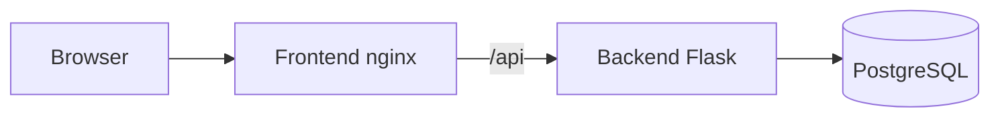

# Three-Tier on Amazon EKS

**Author:** [Yashas Suresh](https://github.com/yashassuresh775)  
**Repo:** https://github.com/yashassuresh775/project-2

Original three-tier application on **Amazon EKS**:

| Tier | Component |
| --- | --- |
| Web | Nginx frontend (static UI + `/api` proxy) |
| API | Flask + Gunicorn backend |
| Data | PostgreSQL 16 |

Infrastructure is provisioned with **Terraform** (VPC + EKS managed node group). Workloads are deployed with **Kubernetes manifests**.

> Inspired by common three-tier EKS labs; this codebase, manifests, and IaC are original.

---

## Architecture

```text
Browser → NLB/LB → Frontend (nginx)
                      │ /api/*
                      ▼
                   Backend (Flask)
                      │
                      ▼
                   PostgreSQL
```



---

## Prerequisites

- AWS CLI v2, Terraform >= 1.5, kubectl, Docker / buildx, Helm (optional)
- AWS credentials with rights to create VPC/EKS/ECR/EC2

---

## 1) Local run (Docker Compose)

```bash
docker compose up --build
```

Open http://localhost:8080

---

## 2) Provision EKS (Terraform)

```bash
cd terraform
cp terraform.tfvars.example terraform.tfvars
# edit if needed
terraform init
terraform apply
```

Configure kubectl:

```bash
aws eks update-kubeconfig --region us-east-1 --name three-tier-eks
kubectl get nodes
```

---

## 3) Build & push images to ECR

```bash
./scripts/build-push-ecr.sh
# copy the printed BACKEND_IMAGE / FRONTEND_IMAGE values
```

---

## 4) Deploy to the cluster

```bash
export BACKEND_IMAGE=.....
export FRONTEND_IMAGE=.....
./scripts/deploy-k8s.sh
kubectl -n three-tier get svc frontend
```

Visit the LoadBalancer hostname/IP on port 80.

---

## API

- `GET /api/health`
- `GET /api/items`
- `POST /api/items` with `{"name":"..."}`

---

## Cost note

EKS + NAT Gateway + nodes incur ongoing AWS charges. Destroy when done:

```bash
kubectl delete namespace three-tier --ignore-not-found
cd terraform && terraform destroy
```

---

## License

MIT — see [LICENSE](LICENSE).
